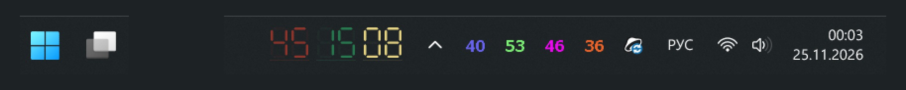
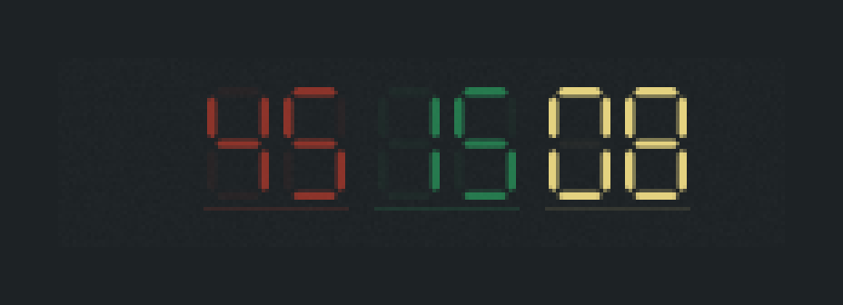
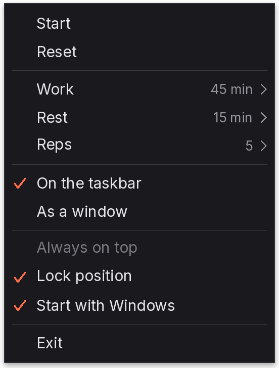

# Pomodoro

A minimalist [Pomodoro](https://en.wikipedia.org/wiki/Pomodoro_Technique) timer that lives on the Windows 11 taskbar.

Three seven-segment counters, no labels: **work in red**, **rest in green**, **repetitions in yellow**. Right-click the strip for settings. That is the whole interface.





## Features

- Sits on the taskbar, left of the clock, without covering Start or the pinned icons
- Work counts down, then rest runs; after each rest, work starts again and the repetition count drops by one
- A light beep at each boundary
- Right-click menu: start / pause / resume, reset, work and rest length, repetitions, lock position, start with Windows
- Drag the strip when it is unlocked; **Lock position** keeps it put
- Optional floating window, if you would rather not use the taskbar
- Per-pixel transparency so the digits sit on the taskbar background; the full strip is clickable
- A single ~160 KB executable, .NET Framework 4.8, no installer



The menu screenshot is a faithful reconstruction of the English UI (the same type, colors, and items as the app). It was drawn from the source, not captured from a live session.

## How it works

The strip is a top-level, unowned-by-your-apps window with `WS_EX_TOPMOST`, `WS_EX_TOOLWINDOW`, `WS_EX_NOACTIVATE`, and `WS_EX_LAYERED`. It is **owner-docked** to `Shell_TrayWnd` with `SetWindowLongPtr(GWLP_HWNDPARENT)` — the same idea [NetSpeedTray](https://github.com/erez-c137/NetSpeedTray) uses. Owned windows ride above their owner, so when Start or Search raises the taskbar, the strip comes with it. A small out-of-context `SetWinEventHook` plus a short re-assert timer is the backup, not the main trick.

It is deliberately **not** a `WS_CHILD` of Explorer, and it never calls `SetParent` on a shell window.

An earlier build did embed itself with `SetParent`. That attaches the two processes' input queues, so a stall in the timer froze the whole taskbar (Application event 1002, "explorer.exe stopped interacting"). The same build also walked Explorer's UI Automation tree about once a second and leaked around 2.5 GB of private memory over a few days. Those paths are gone. The app only redraws when the digits or phase actually change, and it logs a lightweight memory / GDI / USER sample every ten minutes.

## Build

You need the [.NET 8 SDK](https://dotnet.microsoft.com/download) (used as the build tool) and a Windows machine, or a cross-compile with `EnableWindowsTargeting`. The app itself targets **.NET Framework 4.8**, which is already on current Windows 10 and 11.

```bash
dotnet build Pomodoro.csproj -c Release
dotnet run -c Release --project engine-tests/EngineTests.csproj
```

The executable is `bin/Release/net48/Pomodoro.exe`. On a non-Windows host, add `-p:EnableWindowsTargeting=true` to the build command (you still cannot run the WinForms app there).

`Pomodoro.exe /fast` shortens every minute to one second, which is handy for trying the full cycle.

## Install and usage

1. Copy `Pomodoro.exe` (and the adjacent `.exe.config`, if you have it) to a folder of your choice.
2. Run it. The strip appears on the primary taskbar; a tray icon lands in the notification area.
3. Right-click the strip or the tray icon for the menu.
4. Left-click the strip to start, pause, or resume. Tick **Lock position** before you leave it alone; turn it off if you want to drag the strip.
5. Tick **Start with Windows** if you want it at logon.

Settings are stored in `%APPDATA%\Pomodoro\settings.ini`. A log is written to `%APPDATA%\Pomodoro\log.txt`.

## Known limitations

- Windows only, and tuned for the Windows 11 taskbar. A classic Windows 10 bar should work in overlay mode, but that is not the main target.
- The strip is placed on the primary taskbar only.
- Because this is a top-level window and not a true taskbar child, Start or Search can still win a brief z-order fight. The app re-docks and re-asserts; a flicker is possible.
- No history, statistics, or cloud sync. It is a clock on the taskbar, not a full Pomodoro studio.
- A vertical taskbar is supported in principle (the counters stack), but day-to-day use has been on a bottom bar.

## Contributing and feedback

This is a first open-source release, and feedback is very welcome — especially reports from unusual setups (vertical taskbar, multiple monitors, StartAllBack, Explorer patches, high DPI). Issues and pull requests are open.

## License

[MIT](LICENSE) © 2026 Mikhail Chernikov
